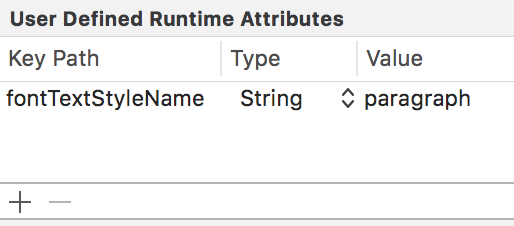
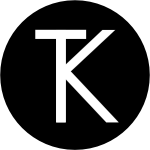

[](https://app.bitrise.io/app/bedbecf19faba2d2)
[](http://cocoapods.org/pods/TypographyKit)
[](https://github.com/Carthage/Carthage)
[](http://cocoapods.org/pods/TypographyKit)
[](http://cocoapods.org/pods/TypographyKit)
[](https://twitter.com/ross_w_butler)
[](https://swift.org/)
[](https://houndci.com)

TypographyKit makes it easy to define typography styles and colour palettes in your iOS app helping you achieve visual consistency in your design as well as supporting [Dynamic Type](https://developer.apple.com/ios/human-interface-guidelines/visual-design/typography/) even when using custom fonts. [[Summary]](https://medium.com/@rwbutler/typographykit-an-ios-framework-to-help-you-support-dynamic-type-and-enable-visual-consistency-bce7e4a82c30) [[Detailed]](https://medium.com/@rwbutler/dynamic-type-in-ios-with-typographykit-9ed0ac5dbf64)

To learn more about how to use TypographyKit, take a look at the table of contents below:

- [Features](#features)
- [What's New in TypographyKit 5.0.0?](#whats-new-in-typographykit-500)
- [Installation](#installation)
	- [Cocoapods](#cocoapods)
	- [Carthage](#carthage)
- [Usage](#usage)
	- [Example App](#example-app)
	- [Configuration](#configuration)
	- [Swift UI](#swift-ui)
		- [Colors](#colors)
		- [Typography (Fonts)](#typography-fonts)
	- [UI Kit](#ui-kit)
		- [Typography Styles](#typography-styles)
		- [Extending Styles](#extending-styles)
		- [Color Palettes](#color-palettes)
		- [UIColor(named:)](#uicolornamed)
		- [Letter Casing](#letter-casing)
		- [Dynamic Type Configuration](#dynamic-type-configuration)
		- [Remote Configuration](#remote-configuration)
- [Contributing](CONTRIBUTING.md)
- [Author](#author)
- [License](#license)
- [Additional Software](#additional-software)
	- [Controls](#controls)
	- [Frameworks](#frameworks)
	- [Tools](#tools)

## Features

- [x] Dynamic Type support for SwiftUI.
- [x] Helps keep your app visually consistent across all screens by allowing you to define all of your typography styles and app color scheme in a single location.
- [x] Host and update your font styles and color schemes [remotely](#remote-configuration). [[Details]](https://medium.com/@rwbutler/remotely-configured-colour-palettes-in-typographykit-e565c927e2b4)
- [x] Dynamic Type support for UIKit (including UILabel, UIButton, UITextField and UITextView as well as some support for NSAttributedString).
	- [x] Support for Dynamic Type using *zero code* (by setting the `fontTextStyleName` key path String to the name of your typography style in Interface Builder). 
- [x] Use either JSON or Property List (.plist) to define your TypographyKit configuration. 
- [x] Use [Palette](https://github.com/rwbutler/TypographyKitPalette) to make the same colour scheme used programmatically available for use in Interface Builder. [[Details]](https://medium.com/@rwbutler/palette-for-typographykit-fd724f324c52)
- [x] Define letter case as part of typography styles with [simple letter case conversion available](#letter-casing).


## What's new in TypographyKit 5.0.0?

- First-class support for SwiftUI colors - to obtain a color, use `TK.color(named:)`.
- You may specify a fallback color to be used in the event that you forget to define a color. Use the `fallback-color` key to specify which color should be used in this case.
    - Setting: `fallback-color`
    - Default: Black in light mode and white in dark mode.
- You may specify a development color which is used in the event that you forget to define a color in development builds. This color may be different from the fallback color. For example, you may want to use an easily noticeable color such as red to make it visually clear that you have forgotten to define a color in development builds. However, you may want to ensure that this red color will never be shown in production builds - this is why development colors will never be shown in production builds (instead the fallback color will be used).
    - Setting: `development-color`
    - Default: `red`
    
    - Setting: `is-development`
    - Default: `true` in #DEBUG builds; `false` otherwise
    
    - Setting: `should-use-development-colors`
    - Default: `true`
    
- You may optionally specify that your development app builds crash if you forget to define a color. This makes it even less likely that you will forget to specify a color value during development. This setting only affects development builds so there is no need to worry that production builds might crash. 
    - Setting: `should-crash-if-color-not-found`
    - Default: `false`

- To start using the framework, now `import TypographyKit` and then configure as follows:

```swift
TypographyKit.configure(
    with: TypographyKitConfiguration.default
        .setConfigurationURL(configurationURL)
)
```

Alternatively, an `async` version of this method exists for developers supporting iOS 13 and above:

```swift
await TypographyKit.configure(with:
    TypographyKitConfiguration.default.setConfigurationURL(configurationURL)
)
```
- All configuration properties specified programmatically may alternatively be specified in the TypographyKit configuration file. 
	- Note: Values in the configuration file override those specified programmatically.

For a detailed list of changes, see [CHANGELOG.md](CHANGELOG.md).

## Installation

### Cocoapods

[CocoaPods](http://cocoapods.org) is a dependency manager which integrates dependencies into your Xcode workspace. To install it using [RubyGems](https://rubygems.org/) run:

```bash
gem install cocoapods
```

To install TypographyKit using Cocoapods, simply add the following line to your Podfile:

```ruby
pod "TypographyKit"
```

Then run the command:

```bash
pod install
```

For more information [see here](https://cocoapods.org/#getstarted).

### Carthage

Carthage is a dependency manager which produces a binary for manual integration into your project. It can be installed via [Homebrew](https://brew.sh/) using the commands:

```bash
brew update
brew install carthage
```

In order to integrate TypographyKit into your project via Carthage, add the following line to your project's Cartfile:

```ogdl
github "rwbutler/TypographyKit"
```

From the macOS Terminal run `carthage update --platform iOS` to build the framework then drag `TypographyKit.framework` into your Xcode project.

For more information [see here](https://github.com/Carthage/Carthage#quick-start).

## Usage
### Example App
An example app exists in the [Example directory](https://github.com/rwbutler/TypographyKit/tree//Example) to provide some pointers on getting started.

### Configuration
Include a TypographyKit.json ([example](https://github.com/rwbutler/TypographyKit/blob/main/Example/TypographyKit/TypographyKit.json)) or TypographyKit.plist ([example](./Example/TypographyKit/TypographyKit.plist)) as part of your app project in which you define your colors and typography styles:

```json
{
    "typography-colors": {
        "background": {
            "dark": "dark royal-blue",
            "light": "lightest gray"
        },
        "gold": "#FFAB01",
        "royal-blue": "#08224C"
    },
    "typography-kit": {
        "labels": {
            "line-break": "word-wrap"
        },
        "minimum-point-size": 10,
        "maximum-point-size": 100,
        "point-step-size": 2,
        "point-step-multiplier": 1,
        "scaling-mode": "uifontmetrics-with-fallback"
    },
    "ui-font-text-styles": {
            "heading": {
            "font-name": "Avenir-Medium",
            "point-size": 36,
            "text-color": "text",
            "letter-case": "regular"
        }
    }
}
```


### Swift UI
#### Colors
#### Typography (Fonts)
Define additional UIFont.TextStyles within your app matching those defined in your .plist:

```swift
extension UIFont.TextStyle
{
    static let heading = UIFont.TextStyle(rawValue: "heading")
}
```

Where you would usually set the text on a UILabel e.g.
```swift
self.titleLabel.text = "My label text"
```

Use TypographyKit's UIKit additions:
```swift
self.titleLabel.text("My label text", style: .heading)
```

Or where your text has been set through IB simply set the UIFont.TextStyle programmatically:
```swift
self.titleLabel.fontTextStyle = .heading
```

If you are happy to use strings, an alternative means of setting the `fontTextStyle` property is to set the key path `fontTextStyleName` on your UIKit element to the string value representing your fontTextStyle - in the example above, this would be 'heading'.



Using this method it is possible to support Dynamic Type in your application with *zero code*.

Your UILabel and UIButton elements will automatically respond to changes in the Dynamic Type setting on iOS on setting a UIFont.TextStyle with no further work needed.

### Typography Styles
Typography styles you define in TypographyKit.plist can optionally include a text color and a letter case.

```xml
	<key>ui-font-text-styles</key>
	<dict>
		<key>heading</key>
		<dict>
			<key>font-name</key>
			<string>Avenir-Medium</string>
			<key>point-size</key>
			<integer>36</integer>
			<key>text-color</key>
			<string>#2C0E8C</string>
			<key>letter-case</key>
			<string>upper</string>
		</dict>
	</dict>
```

### Extending Styles
From version 1.1.3 onwards it is possible to use an existing typography style to create a new one. For example, imagine you would like to create a new style based on an existing one but changing the text color. We can use the `extends` keyword to extend a style that exists already and then specify which properties of the that style to override e.g. the `text-color` property.

We can create a new typography style called `interactive-text` based on a style we have defined already called `paragraph` as follows:

*PLIST*

```xml
<key>paragraph</key>
<dict>
	<key>font-name</key>
	<string>Avenir-Medium</string>
	<key>point-size</key>
	<integer>16</integer>
	<key>text-color</key>
	<string>text</string>
	<key>letter-case</key>
	<string>regular</string>
</dict>
<key>interactive-text</key>
<dict>
	<key>extends</key>
	<string>paragraph</string>
	<key>text-color</key>
	<string>purple</string>
</dict>
```

*JSON*

```json
"paragraph": {
	"font-name": "Avenir-Medium",
	"point-size": 16,
	"text-color": "text",
	"letter-case": "regular"
},
"interactive-text": {
	"extends": "paragraph",
	"text-color": "purple"
}        
```

### Color Palettes
Android has from the start provided developers with the means to define a color palette for an app in the form of the colors.xml file. Colors.xml also allows developers to define colors by their hex values. TypographyKit allows developers to define a color palette for an app by creating an entry in the TypographyKit.plist.

```xml
    <key>typography-colors</key>
    <dict>
        <key>blueGem</key>
        <string>#2C0E8C</string>
    </dict>
```

Colors can be defined using hex values, RGB values or simple colors by using their names e.g. 'blue'.

```xml	
	<key>typography-colors</key>
    <dict>
        <key>blueGem</key>
        <string>rgb(44, 14, 140)</string>
    </dict>
```

Create a UIColor extension to use the newly-defined colors throughout your app:

```swift
extension UIColor {
    static let blueGem: UIColor = TypographyKit.colors["blueGem"]!
}
```    
    
Or:
   
```swift
extension UIColor {
	static let fallback: UIColor = .black
	static let blueGem: UIColor = TypographyKit.colors["blueGem"] ?? fallback
}
```    
 
Your named colors can be used when defining your typography styles in TypographyKit.plist.
 
```xml
 	<key>ui-font-text-styles</key>
	<dict>
		<key>heading</key>
		<dict>
			<key>font-name</key>
			<string>Avenir-Medium</string>
			<key>point-size</key>
			<integer>36</integer>
			<key>text-color</key>
			<string>blueGem</string>
		</dict>
	</dict>
```
	
It is also possible override the text color of a typography style on a case-by-case basis:

```swift
myLabel.text("hello world", style: .heading, textColor: .blue)
```

### UIColor(named:)
TypographyKit supports definition of colors via asset catalogs. Simply include the name of the color as part of your style in the configuration file and if the color is found in your asset catalog it will automatically be applied.

### Letter Casing

Useful String additions are provided to easily convert letter case. 

```swift
let pangram = "The quick brown fox jumps over the lazy dog"
let upperCamelCased = pangram.letterCase(.upperCamel)
print(upperCamelCased)
// prints TheQuickBrownFoxJumpsOverTheLazyDog
```
With numerous convenience functions:

```swift
let upperCamelCased = pangram.upperCamelCased()
// prints TheQuickBrownFoxJumpsOverTheLazyDog

let kebabCased = pangram.kebabCased()
// prints the-quick-brown-fox-jumps-over-the-lazy-dog
```

Typography styles can be assigned a default letter casing.

```xml
	<key>ui-font-text-styles</key>
	<dict>
		<key>heading</key>
		<dict>
			<key>font-name</key>
			<string>Avenir-Medium</string>
			<key>point-size</key>
			<integer>36</integer>
			<key>letter-case</key>
			<string>upper</string>
		</dict>
	</dict>
```

However occasionally, you may need to override the default letter casing of a typography style:

```swift
myLabel.text("hello world", style: .heading, letterCase: .capitalized)
```

### Dynamic Type Configuration
By default, your font point size will increase by 2 points for each notch on the Larger Text slider in the iOS accessibility settings however you may optionally specify how your UIKit elements react to changes in UIContentSizeCategory. 

You may specify your own point step size and multiplier by inclusion of a dictionary with key ```typography-kit``` as part of your ```TypographyKit.json``` (or ```TypographyKit.plist``` if preferred) file.

```xml
<key>typography-kit</key>
<dict>
    <key>minimum-point-size</key>
    <integer>10</integer>
    <key>maximum-point-size</key>
    <integer>100</integer>
    <key>point-step-size</key>
    <integer>2</integer>
    <key>point-step-multiplier</key>
    <integer>1</integer>
</dict>
```

Optionally, you may clamp the font point size to a lower and / or upper bound using the `minimum-point-size` and `maximum-point-size` properties.

### Remote Configuration
TypographyKit also allows you to host your configuration remotely so that your colors and font styles can be updated dynamically. To do so, simply add the following line to your app delegate so that it is invoked when your app finishes launching:

```swift
TypographyKit.configurationURL = URL(string: "https://github.com/rwbutler/TypographyKit/blob/main/Example/TypographyKit/TypographyKit.plist")
```

Your typography styles and colors will be updated the next time your app is launched. However, should you need your styles to be updated sooner you may call ``` TypographyKit.refresh()```.

## Author

[Ross Butler](https://github.com/rwbutler)

## License

TypographyKit is available under the MIT license. See the [LICENSE file](./LICENSE) for more info.

## Additional Software

### Controls

* [AnimatedGradientView](https://github.com/rwbutler/AnimatedGradientView) - Powerful gradient animations made simple for iOS.

|[AnimatedGradientView](https://github.com/rwbutler/AnimatedGradientView) |
|:-------------------------:|
|[](https://github.com/rwbutler/AnimatedGradientView) 

### Frameworks

* [Cheats](https://github.com/rwbutler/Cheats) - Retro cheat codes for modern iOS apps.
* [Connectivity](https://github.com/rwbutler/Connectivity) - Improves on Reachability for determining Internet connectivity in your iOS application.
* [FeatureFlags](https://github.com/rwbutler/FeatureFlags) - Allows developers to configure feature flags, run multiple A/B or MVT tests using a bundled / remotely-hosted JSON configuration file.
* [FlexibleRowHeightGridLayout](https://github.com/rwbutler/FlexibleRowHeightGridLayout) - A UICollectionView grid layout designed to support Dynamic Type by allowing the height of each row to size to fit content.
* [Hash](https://github.com/rwbutler/Hash) - Lightweight means of generating message digests and HMACs using popular hash functions including MD5, SHA-1, SHA-256.
* [Skylark](https://github.com/rwbutler/Skylark) - Fully Swift BDD testing framework for writing Cucumber scenarios using Gherkin syntax.
* [TailorSwift](https://github.com/rwbutler/TailorSwift) - A collection of useful Swift Core Library / Foundation framework extensions.
* [TypographyKit](https://github.com/rwbutler/TypographyKit) - Consistent & accessible visual styling on iOS with Dynamic Type support.
* [Updates](https://github.com/rwbutler/Updates) - Automatically detects app updates and gently prompts users to update.

|[Cheats](https://github.com/rwbutler/Cheats) |[Connectivity](https://github.com/rwbutler/Connectivity) | [FeatureFlags](https://github.com/rwbutler/FeatureFlags) | [Skylark](https://github.com/rwbutler/Skylark) | [TypographyKit](https://github.com/rwbutler/TypographyKit) | [Updates](https://github.com/rwbutler/Updates) |
|:-------------------------:|:-------------------------:|:-------------------------:|:-------------------------:|:-------------------------:|:-------------------------:|
|[](https://github.com/rwbutler/Cheats) |[](https://github.com/rwbutler/Connectivity) | [](https://github.com/rwbutler/FeatureFlags) | [](https://github.com/rwbutler/Skylark) | [](https://github.com/rwbutler/TypographyKit) | [](https://github.com/rwbutler/Updates)

### Tools

* [Clear DerivedData](https://github.com/rwbutler/ClearDerivedData) - Utility to quickly clear your DerivedData directory simply by typing `cdd` from the Terminal.
* [Config Validator](https://github.com/rwbutler/ConfigValidator) - Config Validator validates & uploads your configuration files and cache clears your CDN as part of your CI process.
* [IPA Uploader](https://github.com/rwbutler/IPAUploader) - Uploads your apps to TestFlight & App Store.
* [Palette](https://github.com/rwbutler/TypographyKitPalette) - Makes your [TypographyKit](https://github.com/rwbutler/TypographyKit) color palette available in Xcode Interface Builder.

|[Config Validator](https://github.com/rwbutler/ConfigValidator) | [IPA Uploader](https://github.com/rwbutler/IPAUploader) | [Palette](https://github.com/rwbutler/TypographyKitPalette)|
|:-------------------------:|:-------------------------:|:-------------------------:|
|[](https://github.com/rwbutler/ConfigValidator) | [](https://github.com/rwbutler/IPAUploader) | [](https://github.com/rwbutler/TypographyKitPalette)


## 🌐 Web Resources & Aesthetic Symbols Index
- [SYM 1D47A](https://vintage-runes-text-35.pages.dev/symbol/sym-1d47a/)
- [SYM 1D486](https://glitch-mecha-fonts-37.pages.dev/symbol/sym-1d486/)
- [SYM 1D44C](https://clean-line-emojis-93.pages.dev/symbol/sym-1d44c/)
- [SYM 1F60E](https://ethereal-goth-symbols-29.pages.dev/symbol/sym-1f60e/)
- [SYM 1F623](https://dollcore-bio-symbols-12.pages.dev/symbol/sym-1f623/)
- [KAOMOJI](https://kawaii-kaomoji-hub-80.pages.dev/ru/kaomoji/)
- [SIXTEEN POINTED STAR](https://minimal-star-symbols-28.pages.dev/symbol/sixteen-pointed-star/)
- [SYM 1F499](https://kawaii-kaomoji-hub-17.pages.dev/symbol/sym-1f499/)
- [SYM 2683](https://kawaii-kaomoji-hub-80.pages.dev/symbol/sym-2683/)
- [ROYAL GOLD CROWN](https://chibi-faces-hub-88.pages.dev/symbol/royal-gold-crown/)
- [SYM 1D452](https://raven-gothic-text-44.pages.dev/symbol/sym-1d452/)
- [SYM 26A4](https://occult-aesthetic-symbols-26.pages.dev/symbol/sym-26a4/)
- [HEAVY HEART EXCLAMATION](https://baroque-font-vault-96.pages.dev/symbol/heavy-heart-exclamation/)
- [GOTHIC OBSIDIAN SKULL CREST](https://simple-line-symbols-28.pages.dev/symbol/gothic-obsidian-skull-crest/)
- [SYM 1D4A4](https://minimal-star-symbols-63.pages.dev/symbol/sym-1d4a4/)
- [SYM 1D456](https://occult-aesthetic-symbols-26.pages.dev/symbol/sym-1d456/)
- [SYM 1F643](https://vintage-scholar-text-78.pages.dev/symbol/sym-1f643/)
- [SYM 2654](https://anime-sparkle-text-73.pages.dev/symbol/sym-2654/)
- [SYM 26C1](https://dark-scholarly-symbols-65.pages.dev/symbol/sym-26c1/)
- [SYM 26F2](https://kawaii-kaomoji-hub-80.pages.dev/symbol/sym-26f2/)
- [ROTATED FLORAL HEART](https://chibi-emoticon-lab-65.pages.dev/symbol/rotated-floral-heart/)
- [SYM 268F](https://occult-aesthetic-symbols-26.pages.dev/symbol/sym-268f/)
- [SYM 26C3](https://occult-aesthetic-symbols-26.pages.dev/symbol/sym-26c3/)
- [SYM 2636](https://anime-sparkle-text-73.pages.dev/symbol/sym-2636/)
- [SINGLE EIGHTH MUSICAL NOTE](https://zen-unicode-text-36.pages.dev/symbol/single-eighth-musical-note/)
- [SYM 1D482](https://kawaii-kaomoji-hub-17.pages.dev/symbol/sym-1d482/)
- [STARS](https://soft-angel-symbols-61.pages.dev/ja/stars/)
- [SYM 1F922](https://gothic-bio-fonts-87.pages.dev/symbol/sym-1f922/)
- [SYM 26A3](https://kawaii-kaomoji-hub-80.pages.dev/symbol/sym-26a3/)
- [HEARTS](https://baroque-font-vault-96.pages.dev/es/hearts/)
- [FREEFIRE NAMES](https://baroque-font-vault-96.pages.dev/pt/freefire-names/)
- [SYM 268D](https://kawaii-kaomoji-hub-80.pages.dev/symbol/sym-268d/)
- [BORDERS DIVIDERS](https://baroque-font-vault-96.pages.dev/pt/borders-dividers/)
- [SYM 2747](https://zen-unicode-hub-94.pages.dev/symbol/sym-2747/)
- [SYM 2745](https://coquette-aesthetic-symbols-45.pages.dev/symbol/sym-2745/)
- [SIXTEEN POINTED STAR](https://zen-unicode-hub-94.pages.dev/symbol/sixteen-pointed-star/)
- [SYM 1F927](https://aesthetic-bullet-points-76.pages.dev/symbol/sym-1f927/)
- [ANGEL WINGS HEART](https://zen-unicode-text-36.pages.dev/symbol/angel-wings-heart/)
- [RIGHTWARDS PAIRED HARPOON](https://occult-aesthetic-symbols-26.pages.dev/symbol/rightwards-paired-harpoon/)
- [SYM 1D456](https://sleek-bio-symbols-40.pages.dev/symbol/sym-1d456/)
- [SYM 1D407](https://cyber-clan-tags-65.pages.dev/symbol/sym-1d407/)
- [SYM 1D454](https://minimal-star-symbols-89.pages.dev/symbol/sym-1d454/)
- [OPEN CENTRE STAR](https://gothic-bio-fonts-32.pages.dev/symbol/open-centre-star/)
- [SYM 1D464](https://raven-gothic-text-44.pages.dev/symbol/sym-1d464/)
- [CUTE BUNNY RABBIT FACE](https://gothic-bio-fonts-87.pages.dev/symbol/cute-bunny-rabbit-face/)
- [PISCES ZODIAC FISHES](https://geometric-bio-symbols-76.pages.dev/symbol/pisces-zodiac-fishes/)
- [SKULL AND CROSSBONES](https://gothic-bio-fonts-87.pages.dev/symbol/skull-and-crossbones/)
- [DISCORD STATUS](https://zen-unicode-text-36.pages.dev/vi/discord-status/)
- [SYM 1D48B](https://baroque-crown-unicode-60.pages.dev/symbol/sym-1d48b/)
- [CLOUD WEATHER SYMBOL](https://zen-unicode-hub-94.pages.dev/symbol/cloud-weather-symbol/)
- [SYM 1D48D](https://minimal-star-symbols-91.pages.dev/symbol/sym-1d48d/)
- [SYM 265E](https://aesthetic-sparkle-text-48.pages.dev/symbol/sym-265e/)
- [HEAVY HEART EXCLAMATION](https://dark-scholarly-symbols-65.pages.dev/symbol/heavy-heart-exclamation/)
- [SYM 2673](https://occult-aesthetic-symbols-26.pages.dev/symbol/sym-2673/)
- [SYM 1F603](https://zen-aesthetic-fonts-87.pages.dev/symbol/sym-1f603/)
- [SYM 1F913](https://zen-aesthetic-fonts-87.pages.dev/symbol/sym-1f913/)
- [SYM 1F972](https://techno-hacker-text-43.pages.dev/symbol/sym-1f972/)
- [SYM 1F635](https://geometric-bio-symbols-76.pages.dev/symbol/sym-1f635/)
- [GEORGIAN LOVE HEART](https://anime-sparkle-text-76.pages.dev/symbol/georgian-love-heart/)
- [SYM 1D463](https://vintage-angel-text-38.pages.dev/symbol/sym-1d463/)
- [BLUSHING SOFT SMILE KAOMOJI](https://coquette-aesthetic-symbols-71.pages.dev/symbol/blushing-soft-smile-kaomoji/)
- [SYM 1D4A2](https://gothic-bio-fonts-32.pages.dev/symbol/sym-1d4a2/)
- [SYM 265C](https://sleek-line-unicode-29.pages.dev/symbol/sym-265c/)
- [SYM 1F625](https://cyber-clan-tags-65.pages.dev/symbol/sym-1f625/)
- [SYM 2635](https://glitch-mecha-kaomoji-69.pages.dev/symbol/sym-2635/)
- [RADIOACTIVE SYMBOL](https://vintage-scholar-text-15.pages.dev/symbol/radioactive-symbol/)
- [SYM 26E2](https://clean-spacing-fonts-98.pages.dev/symbol/sym-26e2/)
- [SYM 1D435](https://vintage-lace-fonts-79.pages.dev/symbol/sym-1d435/)
- [SYM 1F621](https://sleek-line-unicode-29.pages.dev/symbol/sym-1f621/)
- [SYM 2732](https://cyber-clan-tags-65.pages.dev/symbol/sym-2732/)
- [SYM 1F61A](https://geometric-bio-symbols-76.pages.dev/symbol/sym-1f61a/)
- [SYM 1D49D](https://archival-rune-symbols-42.pages.dev/symbol/sym-1d49d/)
- [SYM 2684](https://mecha-gamer-fonts-53.pages.dev/symbol/sym-2684/)
- [SYM 2632](https://neon-matrix-symbols-94.pages.dev/symbol/sym-2632/)
- [CANCER ZODIAC CRAB](https://chibi-emoticon-lab-65.pages.dev/symbol/cancer-zodiac-crab/)
- [SYM 262F](https://occult-aesthetic-symbols-26.pages.dev/symbol/sym-262f/)
- [SYM 2731](https://sleek-bio-symbols-40.pages.dev/symbol/sym-2731/)
- [MUSIC FLAT SIGN](https://angelic-coquette-text-10.pages.dev/symbol/music-flat-sign/)
- [LEFT MATHEMATICAL WHITE SQUARE BRACKET](https://cyber-clan-tags-36.pages.dev/symbol/left-mathematical-white-square-bracket/)
- [SYM 26B1](https://cyber-clan-tags-36.pages.dev/symbol/sym-26b1/)
- [TELUGU RIBBON BOWLET](https://pink-bow-kaomoji-37.pages.dev/symbol/telugu-ribbon-bowlet/)
- [TIKTOK CAPTIONS](https://clean-space-text-47.pages.dev/es/tiktok-captions/)
- [SYM 1D409](https://minimal-star-symbols-43.pages.dev/symbol/sym-1d409/)
- [SYM 2685](https://kawaii-kaomoji-hub-80.pages.dev/symbol/sym-2685/)
- [SYM 1F61C](https://zen-unicode-hub-94.pages.dev/symbol/sym-1f61c/)
- [SYM 1D488](https://daintystar-font-studio-48.pages.dev/symbol/sym-1d488/)
- [SYM 1D416](https://mecha-hacker-kaomoji-26.pages.dev/symbol/sym-1d416/)
- [STARS](https://cyber-clan-tags-65.pages.dev/vi/stars/)
- [SYM 1D42A](https://gothic-bio-fonts-32.pages.dev/symbol/sym-1d42a/)
- [FREEFIRE NAMES](https://cyber-clan-tags-65.pages.dev/vi/freefire-names/)
- [SYM 2631](https://pink-bow-kaomoji-37.pages.dev/symbol/sym-2631/)
- [GAMING WEAPONS](https://coquette-aesthetic-symbols-71.pages.dev/pt/gaming-weapons/)
- [VI](https://clean-space-text-47.pages.dev/vi/)
- [SYM 265A](https://cyber-clan-tags-36.pages.dev/symbol/sym-265a/)
- [SYM 1D41E](https://techno-hacker-text-43.pages.dev/symbol/sym-1d41e/)
- [SYM 1D43D](https://raven-gothic-text-44.pages.dev/symbol/sym-1d43d/)
- [SYM 1D470](https://raven-gothic-text-44.pages.dev/symbol/sym-1d470/)
- [SYM 2731](https://coquette-aesthetic-symbols-71.pages.dev/symbol/sym-2731/)
- [SYM 1F635](https://moe-kaomoji-symbols-15.pages.dev/symbol/sym-1f635/)
- [SYM 1F97A](https://vintage-scholar-text-15.pages.dev/symbol/sym-1f97a/)
- [SYM 26CD](https://dollcore-bio-symbols-12.pages.dev/symbol/sym-26cd/)
- [SYM 267B](https://chibi-emoticon-lab-65.pages.dev/symbol/sym-267b/)
- [SYM 1F49C](https://gothic-bio-fonts-87.pages.dev/symbol/sym-1f49c/)
- [ROBLOX NAMES](https://coquette-aesthetic-symbols-29.pages.dev/ja/roblox-names/)
- [SYM 268A](https://ribbon-bow-unicode-18.pages.dev/symbol/sym-268a/)
- [LEFT WING CLAN FLARE](https://chibi-kaomoji-vault-58.pages.dev/symbol/left-wing-clan-flare/)
- [SYM 26DC](https://neon-matrix-symbols-57.pages.dev/symbol/sym-26dc/)
- [SYM 2681](https://sleek-arrow-symbols-42.pages.dev/symbol/sym-2681/)
- [SYM 1F63F](https://simple-line-fonts-11.pages.dev/symbol/sym-1f63f/)
- [SYM 1F606](https://zen-unicode-hub-94.pages.dev/symbol/sym-1f606/)
- [SYM 2683](https://gothic-bio-fonts-87.pages.dev/symbol/sym-2683/)
- [SYM 268F](https://kawaii-kaomoji-hub-80.pages.dev/symbol/sym-268f/)
- [ZODIAC CELESTIAL](https://baroque-font-vault-96.pages.dev/zodiac-celestial/)
- [LEFT WHITE CORNER BRACKET](https://simple-line-fonts-11.pages.dev/symbol/left-white-corner-bracket/)
- [SYM 1D432](https://pink-bow-kaomoji-37.pages.dev/symbol/sym-1d432/)
- [SYM 2646](https://occult-runic-fonts-23.pages.dev/symbol/sym-2646/)
- [SYM 1D449](https://cyber-clan-tags-65.pages.dev/symbol/sym-1d449/)
- [SYM 1F614](https://sleek-arrow-symbols-42.pages.dev/symbol/sym-1f614/)
- [SYM 1F622](https://sleek-arrow-symbols-42.pages.dev/symbol/sym-1f622/)
- [LEO ZODIAC LION](https://coquette-aesthetic-symbols-62.pages.dev/symbol/leo-zodiac-lion/)
- [SYM 2616](https://gothic-bio-fonts-87.pages.dev/symbol/sym-2616/)
- [SYM 1D403](https://sleek-bio-symbols-40.pages.dev/symbol/sym-1d403/)
- [GEORGIAN LOVE HEART](https://lace-and-ribbon-text-61.pages.dev/symbol/georgian-love-heart/)
- [SYM 1F632](https://sleek-line-unicode-29.pages.dev/symbol/sym-1f632/)
- [SYM 1F64A](https://sleek-arrow-symbols-42.pages.dev/symbol/sym-1f64a/)
- [SYM 1FAE3](https://gothic-bio-fonts-87.pages.dev/symbol/sym-1fae3/)
- [SYM 2682](https://glitch-mecha-kaomoji-69.pages.dev/symbol/sym-2682/)
- [ARROWS LINES](https://anime-sparkle-text-81.pages.dev/arrows-lines/)
- [SYM 1D486](https://techno-hacker-text-43.pages.dev/symbol/sym-1d486/)
- [BRACKETS](https://sleek-arrow-symbols-42.pages.dev/pt/brackets/)
